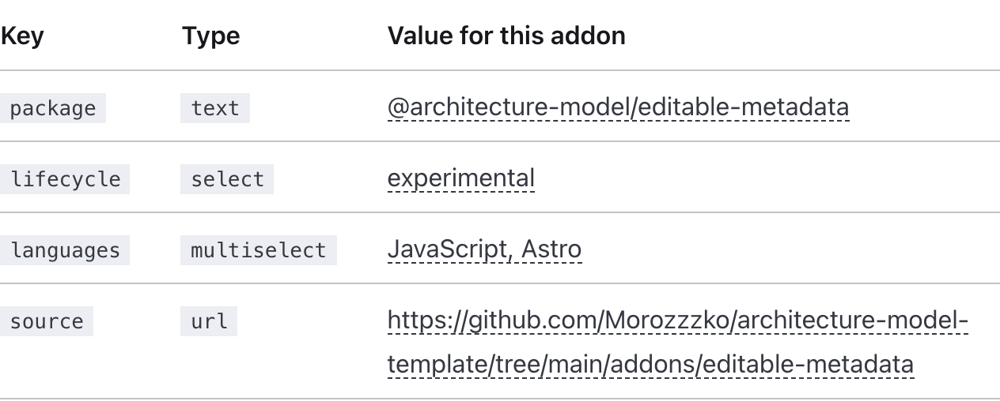
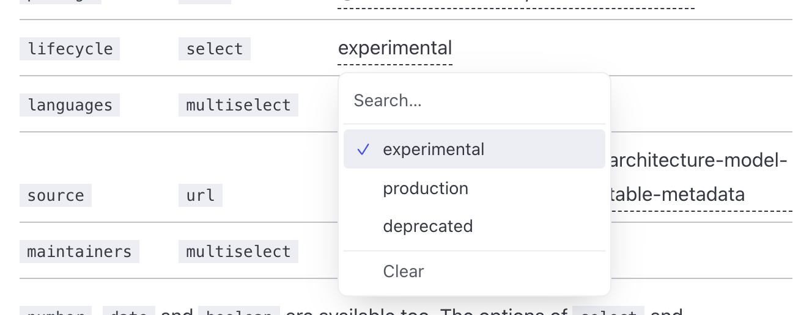
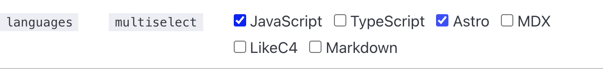
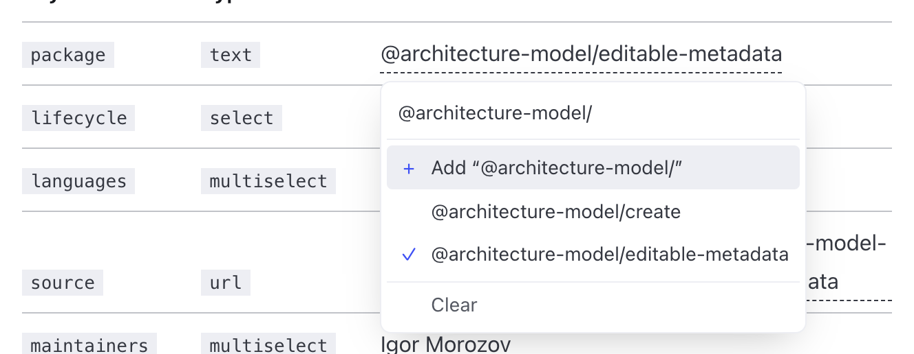
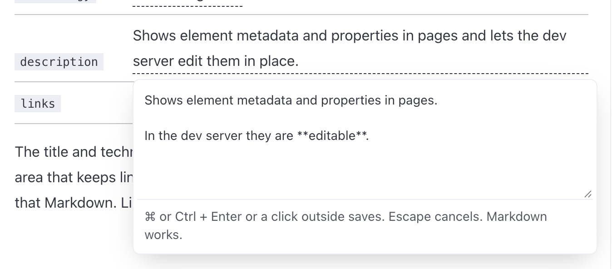
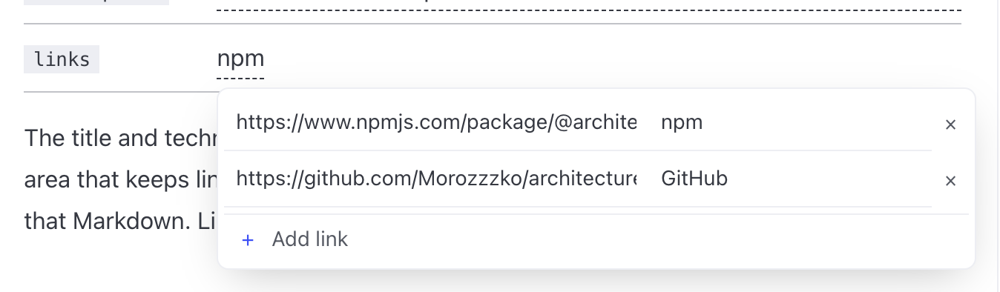

import Metadata from '@architecture-model/editable-metadata/Metadata.astro'
import Property from '@architecture-model/editable-metadata/Property.astro'
import Derived from '@architecture-model/editable-metadata/Derived.astro'
import People from '@architecture-model/editable-metadata/People.astro'
import PeopleTable from '@architecture-model/editable-metadata/PeopleTable.astro'

export const ours = (element, model) => element.id === 'toolkit' || element.isDescendantOf(model.element('toolkit'))
export const usedBy = (element, model) => [
  ...new Set([...element.incoming()].filter(({ source }) => ours(source, model)).map(({ source }) => source.title)),
]
export const callsBack = (element, model) => [...element.outgoing()].some(({ target }) => ours(target, model))

`@architecture-model/editable-metadata` shows the metadata and properties of model elements in documentation pages. The value lives in the model, so a page never disagrees with it.

In `npm run dev` every value is click-to-edit: pick a new one and it is written back to `model/model.c4`. In the built site, like this one, they are read-only: plain text, and links for `url` fields.

```bash
npx astro add @architecture-model/editable-metadata
```

## A value in a sentence

The generator is published as <Metadata of="toolkit.generator" name="package" />, and this addon is <Metadata of="toolkit.editableMetadata" name="lifecycle" />.

```mdx
import Metadata from '@architecture-model/editable-metadata/Metadata.astro'

The generator is published as <Metadata of="toolkit.generator" name="package" />, and this addon is <Metadata of="toolkit.editableMetadata" name="lifecycle" />.
```

`of` is the element's fully qualified name and `name` is the metadata key. The values come from the model:

```
generator = container 'Generator' {
  metadata {
    package '@architecture-model/create'
    lifecycle 'production'
  }
}
```

## Field types

Without configuration every key is text, except the [people keys](#people). `model/metadata.json` gives keys other types, which changes the editor in the dev server and how the value is shown:

```json
{
  "package": { "type": "text" },
  "lifecycle": { "type": "select", "options": ["experimental", "production", "deprecated"] },
  "languages": { "type": "multiselect", "options": ["JavaScript", "TypeScript", "Astro", "MDX", "LikeC4", "Markdown"] },
  "source": { "type": "url" },
  "maintainers": { "type": "multiselect", "options": [{ "value": "morozzzko", "label": "Igor Morozov" }] }
}
```

| Key | Type | Value for this addon |
| --- | --- | --- |
| `package` | `text` | <Metadata of="toolkit.editableMetadata" name="package" /> |
| `lifecycle` | `select` | <Metadata of="toolkit.editableMetadata" name="lifecycle" /> |
| `languages` | `multiselect` | <Metadata of="toolkit.editableMetadata" name="languages" /> |
| `source` | `url` | <Metadata of="toolkit.editableMetadata" name="source" /> |
| `maintainers` | `multiselect` | <Metadata of="toolkit.editableMetadata" name="maintainers" /> |

`number`, `date` and `boolean` are available too, and `people`, which picks from the [shared list of people](#people). The options of `select` and `multiselect` are the listed ones plus every value already in use in the model.

An option is a string, or a value with a label: the model stores `morozzzko`, and pages and editors show Igor Morozov.

## People

"Owner" rarely tells you whom to ask. Every system, ours or a vendor's, can say whom to go to for which job:

| Key | Who | Ask them when |
| --- | --- | --- |
| `integratedBy` | integrated it originally | you need to know why it works the way it does |
| `experts` | know best how it works and how its integration is changed | there is an incident, an API or contract change, an upgrade, or a change to review |
| `contributors` | have worked on it | you need reviewers or extra hands, or the experts are away |
| `administrators` | manage it: for a vendor, the account, keys, billing and support; for our own, its accounts and access | credentials need rotating, someone needs access, or a support ticket or plan change is due |
| `peopleConfirmed` | | the date someone last checked these; older than about six months, check again |

[Model who knows and manages each system](../../people/) says which questions the people fields let the model answer, and why.

The people come from one list, `model/people.json`, as a handle and a name, so a person is added once and every field picks from it. Someone who has left keeps their entry, with `"left": "2026-05-01"`; [Find systems whose people have left](../../recipes/people-who-left/) uses it. `People` shows the fields for one system, with what references it, worked out from the model's relationships:

```mdx
import People from '@architecture-model/editable-metadata/People.astro'

<People of="npm" />
```

<People of="npm" />

`PeopleTable` shows the same for every system, ours and external:

<PeopleTable />

In the dev server each people field is click-to-edit, picking from the list.

## Properties

`Property` shows an element's own properties the same way: `title`, `summary`, `description`, `technology` and `links`.

```mdx
import Property from '@architecture-model/editable-metadata/Property.astro'

<Property of="toolkit.editableMetadata" name="description" />
```

| Property | Value for this addon |
| --- | --- |
| `title` | <Property of="toolkit.editableMetadata" name="title" /> |
| `technology` | <Property of="toolkit.editableMetadata" name="technology" /> |
| `description` | <Property of="toolkit.editableMetadata" name="description" /> |
| `links` | <Property of="toolkit.editableMetadata" name="links" /> |

The title and technology get a one-line input. The summary and description get a text area that keeps line breaks and saves them as Markdown, and the built site renders that Markdown. Links get a URL and a label per row.

## Derived values

A derived value answers a question about the model instead of being written down. The page asks the question: it defines a function of the [element](https://likec4.dev/tooling/model-api/) and the whole model, and `Derived` shows the answer for one element.

```mdx
import Derived from '@architecture-model/editable-metadata/Derived.astro'

export const ours = (element, model) => element.id === 'toolkit' || element.isDescendantOf(model.element('toolkit'))
export const usedBy = (element, model) => [
  ...new Set([...element.incoming()].filter(({ source }) => ours(source, model)).map(({ source }) => source.title)),
]
export const callsBack = (element, model) => [...element.outgoing()].some(({ target }) => ours(target, model))

| External system | Used by | Calls us back |
| --- | --- | --- |
| npm registry | <Derived of="npm" value={usedBy} /> | <Derived of="npm" value={callsBack} /> |
| GitHub Pages | <Derived of="pages" value={usedBy} /> | <Derived of="pages" value={callsBack} /> |
```

| External system | Used by | Calls us back |
| --- | --- | --- |
| npm registry | <Derived of="npm" value={usedBy} /> | <Derived of="npm" value={callsBack} /> |
| GitHub Pages | <Derived of="pages" value={usedBy} /> | <Derived of="pages" value={callsBack} /> |

A function returns a string, a number, a list, or `true` and `false`, shown as Yes and No. A derived value is never editable, and it changes as soon as the relationships in the model change.

## Editing

In the dev server a value has a dashed underline:



Click it, or focus it and press Enter, to open its editor. Type to filter, use the arrow keys to move and Enter to choose. A `select` saves the option you choose:



A `multiselect` toggles options and saves them all when it closes:



`text` suggests the values already used for the key, and adds what you type as a new one:



`number`, `date` and `url` get an input that saves with Enter or a click outside, and `boolean` a switch. Escape closes an editor without saving, and Clear, or an empty value, removes the key.

A description's text area saves with ⌘ or Ctrl + Enter or a click outside:



Links save when their editor closes, and a row without a URL is dropped:



Only links whose URL has a scheme, such as `https:` or `mailto:`, are shown and edited. Relative links, such as an element's link to its own page, are kept when the links are saved, and move into the element's declaration if they were in an `extend` block.

The editors are React components built on [Radix](https://www.radix-ui.com/) and [cmdk](https://cmdk.paco.me/). The addon adds Astro's React integration if the site doesn't have it, and none of the editor code reaches the built site. The dev server rewrites only what was edited in that element and reloads the page.

Editing exists only in the dev server: the endpoint that saves is not part of the built site, and it accepts requests only from the page itself.

The [package README](https://github.com/Morozzzko/architecture-model-template/tree/main/addons/editable-metadata) has every option.
